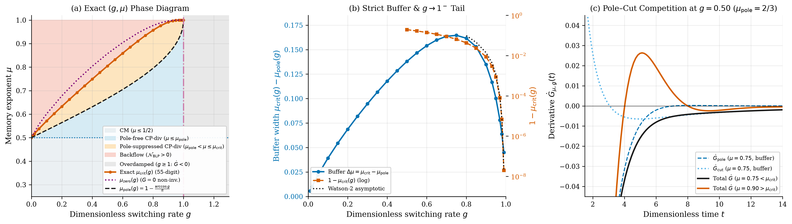
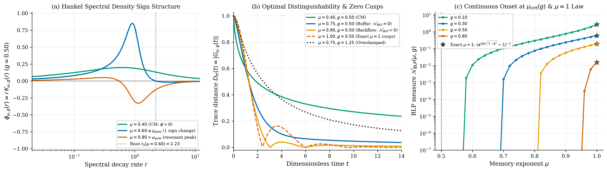
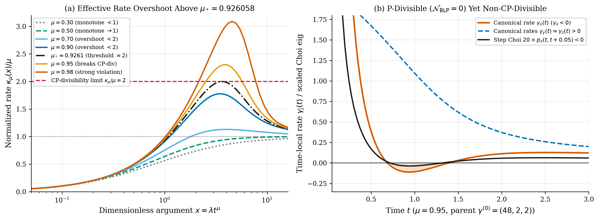
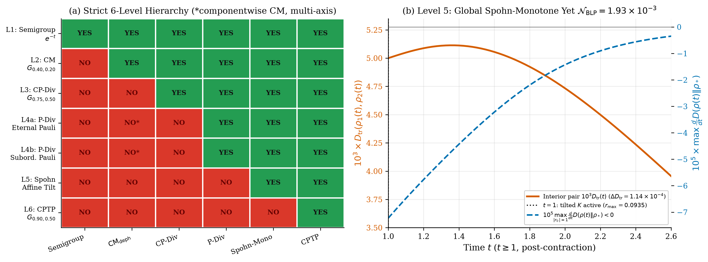
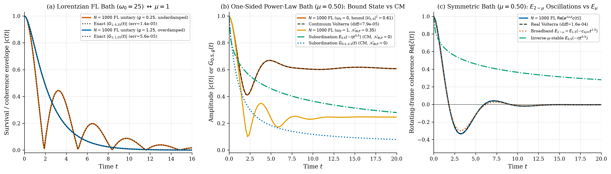

# Exact Analytic Phase Boundary Between Complete Monotonicity, Completely Positive Divisibility, and Information Backflow in Time-Subordinated Open Quantum Dynamics

[](https://github.com/Mehardeep-Singh-GG/subordinated-oqs-phase-boundary/actions/workflows/verify.yml)
[-blueviolet.svg)](lean_proofs/DiamondProofs/Paper2_Subordination.lean)
[](lean_proofs/axioms_check.txt)
[](lean_proofs/axioms_check.txt)
[](requirements.txt)
[](LICENSE)
[](manuscript/paper2_subordinated_oqs.pdf)

Official research repository containing the **pure Lean 4.16.0 formal proofs**, **55- to 95-digit arbitrary-precision contour & 2D Newton solvers**, **Pauli subordination & 6-level hierarchy witnesses**, **$N = 1000$ unitary Friedrichs–Lee simulations**, **strict RFC-8259 datasets**, **vector figures**, and **journal-agnostic LaTeX manuscript & Supplemental Material** for:

> **Mehardeep Singh**, *"Exact Analytic Phase Boundary Between Complete Monotonicity, Completely Positive Divisibility, and Information Backflow in Time-Subordinated Open Quantum Dynamics"*, Sri Chaitanya Educational Institutions.

---

## Executive Summary & Key Quantitative Results

We resolve the exact phase structure of inverse $\mu$-stable time-subordinated random-telegraph / Jaynes–Cummings coherence dynamics, $\tilde{G}_{\mu,g}(s) = s^{\mu-1}(s^\mu + 2g)/(s^{2\mu} + 2g s^\mu + 1)$, alongside general subordinated Pauli semigroups and non-unital affine channels:

| Result / Phase Boundary | Exact Analytic Law / Witness | Verified Precision / Formal Status |
|---|---|---|
| **Complete Monotonicity (Thm. 2)** | $G_{\mu,g}(t)$ is CM on $(0,\infty)$ iff $\mu \in (0, 1/2]$ (all $g > 0$) | Exact Hankel density $K_{\mu,g}(r)$ cross-checked at 70 digits to $\le 2.23\times 10^{-72}$ against $E_\mu, E_{\mu,\mu}$; numerator identities axiom-free in Lean 4 |
| **Pole-Free No-Backflow Wedge (Thm. 4)** | $\dot{G}_{\mu,g}(t) < 0$ strictly for $g \ge 1$ and $g \in (0,1),\; \mu \le \mu_{\mathrm{pole}}(g) := 1 - \arccos(g)/\pi$ | Proved via Single-Sign-Change Positivity (Lean 4 over admissible subspace `Adm`) + Dominated Convergence onto $\mu = \mu_{\mathrm{pole}}(g)$ |
| **Pole-Suppressed Buffer & $g \to 1^-$ Tail (Thm. 5)** | $\mu_{\mathrm{crit}}(g) > \mu_{\mathrm{pole}}(g)$ (peak $\Delta\mu = 0.164606$ at $g=0.75$); $1 - \mu_{\mathrm{crit}}(g) \sim \frac{\pi^2}{2\mathrm{e}(1-g^2)}\exp(-\pi g/\sqrt{1-g^2})$ | 80-digit 2D Newton across 25 $g$-values (residuals $\le 10^{-82}$); 75-digit 2D Newton $\mu_{\mathrm{zero}}(g)$ (residuals $\le 10^{-64}$); matches $\mathcal{N}_{\mathrm{BLP}}(1,g)$ to $\le 6.82\times 10^{-54}$ |
| **Pauli Subordination Breakdown (Thm. 6 & Prop. 7)** | Global subadditivity of $\kappa_\mu(x)$ proved via Pollard log-convexity; breakdown at $\mu_* = 0.9260578001565031\dots$ ($x_* = 3.6356687519943545\dots$) | 75- vs. 95-digit agreement $3.0\times 10^{-77}$ (residuals $\le 1.8\times 10^{-96}$); $\mu=0.95$ witness is P-divisible & componentwise CM yet non-CP-divisible ($p_x = -0.00202935$) |
| **Strict 6-Level Hierarchy (Sec. IV.B)** | $\mathrm{SG} \subsetneq \mathrm{CM}_{\mathrm{deph}} \subsetneq \mathrm{CP\text{-}Div} \subsetneq \mathrm{P\text{-}Div} \subsetneq \mathrm{Spohn} \subsetneq \mathrm{CPTP}$ | Level 5 non-unital affine tilt: global $\mathcal{N}_{\mathrm{BLP}} = 1.9329\times 10^{-3}$, reachable ball $r \le 0.093479 < 0.095$ ($\sup \dot{D}/r^2 = -0.21714 < 0$), analytic Gershgorin CPTP for all $t \ge 1$ certified in Lean 4 |
| **Microscopic $N = 1000$ Friedrichs–Lee (Sec. V)** | Lorentzian ($G_{1,g}$), one-sided bound-state ($|e\rangle,|g\rangle$ optimal AD BLP), symmetric broadband ($E_{2-\mu}$) | Unitarity $1 \pm 10^{-15}$, fine grid $\Delta t = 0.002$ on $[0, 20]$, Volterra agreement $\le 4.46\times 10^{-4}$ |

---

## Publication Figures

<p align="center">
  
  <br/>
  <em><b>Figure 1.</b> Exact $(g,\mu)$ phase diagram, pole-suppressed CP-divisible buffer width $\mu_{\mathrm{crit}} - \mu_{\mathrm{pole}}$, super-exponential $g \to 1^-$ tail, and pole-vs-cut derivative competition.</em>
</p>

<p align="center">
  
  <br/>
  <em><b>Figure 2.</b> Signed Hankel spectral weight $\phi_{\mu,g}(r)$, optimal trace distance $|G_{\mu,g}(t)|$, and continuous onset of $\mathcal{N}_{\mathrm{BLP}}(\mu,g)$ onto the $\mu=1$ closed form.</em>
</p>

<p align="center">
  
  <br/>
  <em><b>Figure 3.</b> Normalized Pauli subordination rate $\kappa_\mu(x)/\mu$ crossing the CP-divisibility ceiling at $\mu_* = 0.926058$, and the $\mu=0.95$ P-divisible non-CP-divisible witness.</em>
</p>

<p align="center">
  
  <br/>
  <em><b>Figure 4.</b> Strict six-level inclusion matrix (marking componentwise-CM multi-axis Pauli witnesses) and Level 5 globally Spohn-monotone witness violating P-divisibility ($\mathcal{N}_{\mathrm{BLP}} = 1.93\times 10^{-3}$).</em>
</p>

<p align="center">
  
  <br/>
  <em><b>Figure 5.</b> $N=1000$ non-uniform Gauss–Legendre unitary Friedrichs–Lee dynamics contrasting resonant Lorentzian, bound-state one-sided power-law, and oscillatory symmetric $E_{2-\mu}$ baths against operational-time subordination.</em>
</p>

---

## Repository Structure

```text
subordinated-oqs-phase-boundary/
├── .github/workflows/verify.yml       # Continuous Integration (Lean 4.16.0 + RFC-8259 JSON + mpmath unit tests)
├── CITATION.cff                       # Machine-readable citation metadata
├── .zenodo.json                       # Zenodo archival metadata
├── LICENSE                            # MIT License
├── requirements.txt                   # Scientific Python dependencies
├── lean_proofs/
│   ├── lean-toolchain                 # leanprover/lean4:v4.16.0
│   ├── lakefile.toml                  # Standalone Lean 4 package config (zero external dependencies)
│   ├── axioms_check.txt               # Full Lean 4.16.0 kernel axiom audit (all 28 headline theorems)
│   └── DiamondProofs/
│       └── Paper2_Subordination.lean  # 2,935 lines, pure Init, 150 authored public theorems
├── src/
│   ├── mpmath_propagator.py           # 70-digit Mittag-Leffler & Hankel contour/Sokhotski–Plemelj engine
│   ├── blp_exact_helper.py            # High-precision zero/extremum-splitting BLP & RHP integrator
│   ├── test_mpmath_core.py            # Fast arbitrary-precision core verification tests
│   ├── save_crosscheck_50digit.py     # 70-digit ML vs. Hankel cross-check across all 11 regimes
│   ├── resolve_phase_boundary.py      # 80-digit 2D Newton solver for mu_crit(g) (25 coupling points)
│   ├── find_mu_zero_boundary.py       # 75-digit 2D Newton solver for mu_zero(g) (13 coupling points)
│   ├── verify_finiteness_and_asymptotics.py # Finite backflow lobes & g -> 1^- Watson asymptotics
│   ├── pauli_hierarchy.py             # 95-digit 2D Newton mu_*, asymmetric margin sweep, 3D Pauli scans
│   ├── generate_hierarchy_data.py     # All 6 hierarchy witnesses, Level 5 reachable ball & global BLP
│   ├── friedrichs_lee_unitary.py      # N=1000 Gauss–Legendre unitary baths & optimal AD BLP
│   ├── generate_figure_trajectories.py # High-resolution trajectory curves for Figs. 1–2
│   └── make_figures.py                # Vector PDF + PNG publication figure generator
├── data/                              # 10 verified strict RFC-8259 JSON & CSV datasets
├── figures/                           # Figures 1–5 (vector PDF + high-DPI PNG)
├── manuscript/
│   ├── paper2_subordinated_oqs.tex/.pdf # Main manuscript (journal-agnostic preprint; 16 pages)
│   └── supplement_paper2.tex/.pdf       # Supplemental Material (complete proofs & 55-digit tables; 11 pages)
└── scripts/
    └── ci_audit.py                    # End-to-end Lean + RFC-8259 JSON + mpmath unit test verifier
```

---

## Pure Lean 4.16.0 Formal Verification

The formalization in [`lean_proofs/DiamondProofs/Paper2_Subordination.lean`](lean_proofs/DiamondProofs/Paper2_Subordination.lean) is **100% self-contained on Lean 4.16.0 `Init`** — zero Mathlib imports, zero `sorry`/`admit`, zero custom axioms, and zero `native_decide`/`Lean.ofReduceBool`:

- **Size & Scope:** 2,935 lines | **150** explicitly authored public theorems (+ 46 private lemmas = 196 authored total) | **211** public kernel `thmInfo` entries (**165** axiom-free) | **28** headline `#print axioms` theorems:
  - **18 universal algebraic & functional theorems** over arbitrary fields (14 axiom-free, including Hankel numerators, overdamped & underdamped root classification, `PositiveLinearFunctional` with admissible linear subspace `Adm`, geometric series, Fujiwara–Algoet Choi diagonalization, $[0,\infty)$-domain Pauli criterion, and universal Gershgorin sum-of-rank-1 $4\times 4$ non-unital Choi PSD `choiNonUnital_isPSD_of_gershgorin`).
  - **4 rational box / interval certificates** over `Q` (including `sep_pdiv_spohn_uniform_cptp`, certifying global CPTP of Level 5 for *all* $t \ge 1$ simultaneously across $[0, 1/20]^3$, and `sep_pdiv_spohn_bkm_vs_blp`).
  - **6 exact single-point rational separation witnesses** over `Q`.
- **Axiom Purity & Kernel Replay:** Audited via `Lean.collectAxioms` in [`lean_proofs/axioms_check.txt`](lean_proofs/axioms_check.txt) — `DISALLOWED_AXIOMS = 0`, **14 / 28 headline theorems depend on zero axioms `[]`** — and replayed from an empty environment in GitHub Actions CI via `lean4checker -v --fresh` (v4.16.0) to rule out environment tampering.

### Quick Verification
```bash
cd lean_proofs
lake build DiamondProofs.Paper2_Subordination
```

Or run the full automated verification suite (Lean static soundness scan + `lake build` + axiom audit + strict RFC-8259 JSON + `mpmath` core unit tests):
```bash
python3 scripts/ci_audit.py
```

---

## Reproducing All Numerical Datasets, Figures, and PDFs

```bash
# 1. Install Python dependencies
pip install -r requirements.txt

# 2. Reproduce all numerical verification datasets in data/
python3 src/test_mpmath_core.py
python3 src/save_crosscheck_50digit.py
python3 src/resolve_phase_boundary.py
python3 src/find_mu_zero_boundary.py
python3 src/verify_finiteness_and_asymptotics.py
python3 src/pauli_hierarchy.py
python3 src/generate_hierarchy_data.py
python3 src/friedrichs_lee_unitary.py
python3 src/generate_figure_trajectories.py

# 3. Regenerate all 5 vector figures in figures/
python3 src/make_figures.py

# 4. Compile manuscript & Supplemental Material (zero warnings/overfulls)
cd manuscript
tectonic paper2_subordinated_oqs.tex
tectonic supplement_paper2.tex
```

---

## Citation

If you use this code, dataset, or Lean 4 formalization, please cite the accompanying manuscript (see also [`CITATION.cff`](CITATION.cff)):

```bibtex
@misc{Singh2026SubordinatedOQS,
  author  = {Singh, Mehardeep},
  title   = {Exact Analytic Phase Boundary Between Complete Monotonicity,
             Completely Positive Divisibility, and Information Backflow
             in Time-Subordinated Open Quantum Dynamics},
  year    = {2026},
  note    = {Manuscript, numerical dataset, and pure Lean 4.16.0 formalization},
  url     = {https://github.com/Mehardeep-Singh-GG/subordinated-oqs-phase-boundary}
}
```

## License

This project is released under the [MIT License](LICENSE).
